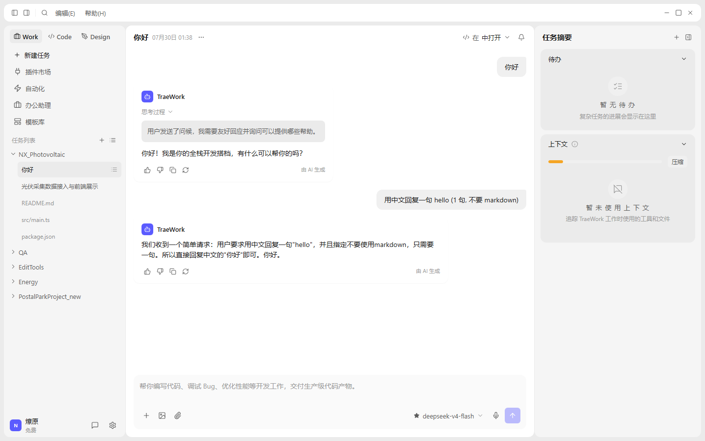
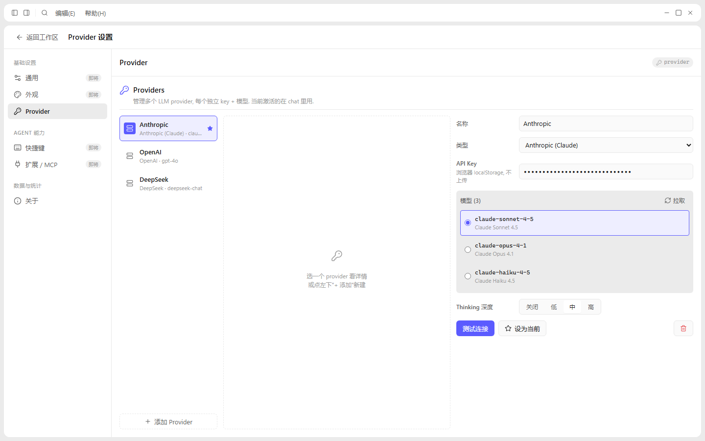
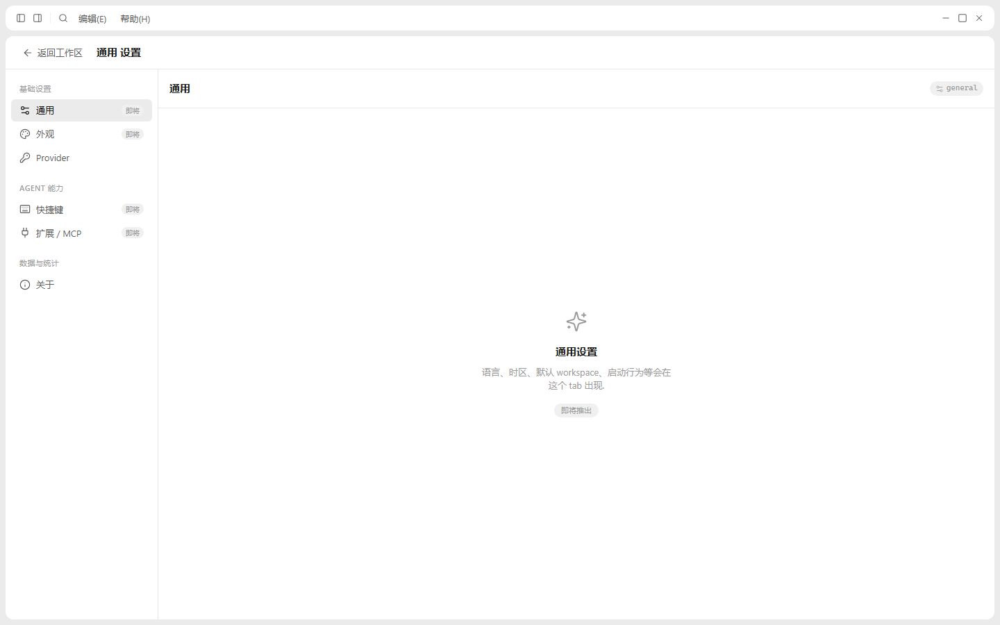
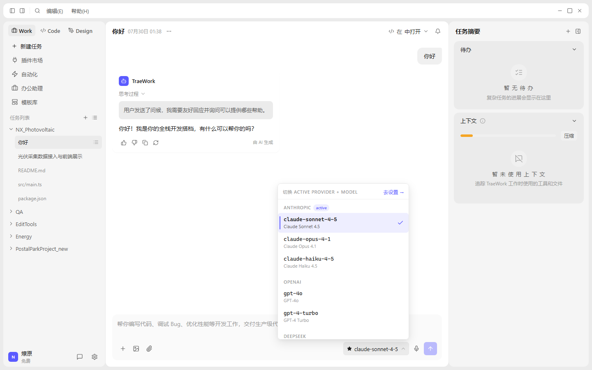
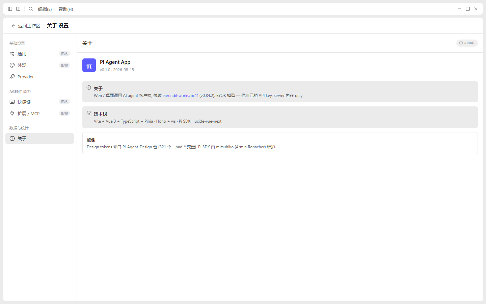

<div align="center">

# Pi Agent

**一个用 Tauri 2 + Vue 3 写的桌面 AI Agent 客户端**

BYOM 架构 · 你自己的 API key，server 内存 only

[](LICENSE)
[](#️-重要说明本项目已停止维护)
[](https://tauri.app)
[](https://vuejs.org)
[](https://www.npmjs.com/package/@earendil-works/pi-coding-agent)

</div>

---

## ⚠️ 重要说明：本项目已停止维护

> **本仓库仅供学习与参考，不是活跃项目。**
>
> 这是我 2026 年 8 月的个人项目，前后约 10 天，用来探索"桌面 AI Agent 客户端"这个方向。项目收笔时功能未完全开发完成，存在已知缺陷和未完成模块。
>
> - **不会修复 bug**，不会跟进上游 SDK 升级，不会回应 issue 和 PR
> - 代码仅代表当时（2026-08）的认知和技术水平，很多地方现在看很粗糙
> - 如果你想 fork 走自己的路，完全欢迎，但请自己承担维护成本
>
> 看代码、学架构、抄思路，都没问题。**请不要指望它能直接用。**

---

## 这是什么

一个 Windows 桌面端的 AI Agent 客户端，包装了 [Pi SDK](https://www.npmjs.com/package/@earendil-works/pi-coding-agent)（Armin Ronacher 维护的 `pi` coding agent）：

- **BYOM 架构** — API key 存在你本机 `settings.json`，server 端不持久化
- **多 Provider** — 内置 Anthropic / OpenAI / DeepSeek 等，也可自配任意 OpenAI-compatible 端点
- **真能干活** — 读写文件、执行命令、调用 MCP server、跑 external tool，不只是聊天
- **内嵌浏览器** — LLM 可以自己开网页、看内容、截图识图



---

## 功能截图

### Provider / 模型配置

支持多 Provider 并存，每个独立 key + 模型列表，可随时切换当前激活的。



### 通用设置

上下文窗口压缩策略、权限模式、思考深度等。



### Composer 能力菜单

`/` 触发 slash command、`@` 引用文件、`[[ref]]` 引用 skill / MCP server / tool，支持图片和文件拖拽上传。



### 关于页



---

## 架构

```
┌──────────────────────────────────────────────┐
│  Vue 3 前端 (Pinia + TypeScript + Vite)      │
│  chat store / 消息渲染 / 设置面板 / 文件树      │
└──────────────┬───────────────────────────────┘
               │ Tauri IPC (invoke + event)
┌──────────────▼───────────────────────────────┐
│  Rust 主进程 (Tauri 2)                        │
│  · WebView2 窗口管理（主窗口 / 浏览器面板）      │
│  · sidecar 进程 spawn / 生命周期管理           │
│  · Windows Job Object 沙箱（内存/进程/CPU 限制） │
│  · 文件读写 / 截图 / 浏览器 reverse RPC         │
└──────────────┬───────────────────────────────┘
               │ stdio JSON-RPC (spawn-per-prompt)
┌──────────────▼───────────────────────────────┐
│  Node sidecar (bun 单文件编译)                │
│  Pi SDK 0.84.2 agent loop                     │
│  · MCP client / external tool / user tool      │
│  · config 热重载 watcher                       │
└──────────────────────────────────────────────┘
```

**几个值得一提的设计**：

| 设计 | 为什么这么做 |
|---|---|
| **spawn-per-prompt sidecar** | 每次发消息起一个新 Node 进程，配置改动天然生效，不用做热重载状态机。代价是每次 ~200MB 启动开销 |
| **Windows Job Object 沙箱** | sidecar 进程限制 1GB 内存 / 100 子进程 / 单核 CPU，防止失控的 tool 调用拖垮整机 |
| **localStorage 而非 DB** | 聊天记录本来就不大，浏览器存储省一个原生依赖。代价是受 5MB quota 限制 |
| **零 UI 组件库** | 手写 CSS（`--pad-*` design token），为了完全控制视觉。见 `Pi-Agent-Design.design/` |
| **ADR 驱动决策** | 27 份架构决策记录在 `doc/04-adr/`，每个非平凡决策的背景和取舍都写清楚了 |

---

## 怎么跑起来

### 环境要求

- Windows 10 / 11 64-bit
- [Node.js](https://nodejs.org) ≥ 20.19.0
- [Rust toolchain](https://rustup.rs)（stable）
- [Bun](https://bun.sh)
- Visual Studio 2022 Build Tools（勾选「使用 C++ 的桌面开发」）
- WebView2 Runtime（Win10/11 已预装）

### 构建

```powershell
# 1. 装前端依赖
npm install --prefix app

# 2. 编译 sidecar（bun 单文件 exe）+ 打包 Tauri debug 版
node scripts/build-debug.mjs
```

产物在 `src-tauri/target/debug/pi-agent-desktop.exe`，直接双击运行（debug 版默认开 F12 devtools）。

release 打包（生成 MSI / NSIS 安装包）：

```powershell
node scripts/build-sidecar-stage1.mjs
cargo tauri build
```

### 配置

首次启动后：

1. 打开 **设置 → Provider**
2. 填入你的 API key 和 base URL（或选内置 provider）
3. 点「拉取」获取模型列表，选一个模型
4. 点「测试连接」验证连通
5. 点「设为当前」

key 存在 `%APPDATA%\com.piagent.desktop\settings.json`，纯明文。**这是为了避免 Windows Credential Manager 的解析延迟（实测会让 send_prompt 链路慢 60 秒），代价是明文落盘。自己权衡。**

---

## 已知问题

收笔时未修复的问题，按严重程度排：

### 🔴 会导致功能不可用

- **大图 / 大量图消息可能触发 OOM** — 图片以 base64 常驻前端内存，多图 + 长对话累积会让 WebView2 渲染进程内存爆掉。项目里 [ADR-0026](doc/04-adr/0026-oom-deep-analysis.md) 有完整分析，[ADR-0027](doc/04-adr/0027-oom-root-fix.md) 做了部分缓解（去掉 base64 落库 + 持久化 debounce + `content-visibility`），但**没有做完整的虚拟滚动**，长对话仍有风险
- **长 session 的上下文管理是半成品** — 侧边栏任务摘要、上下文 token 面板等功能不完整
- **多 Agent persona 功能做过但回滚了** — 见 [ADR-0090](doc/04-adr/0090-multi-agent-persona-superseded.md)，代码痕迹还在

### 🟡 影响体验

- **流式显示做过多轮实验后回滚** — 当前是朴素的逐字追加，没有渐显 / 节流 / 遮罩。相关 commit 在 git 历史里（v3.60.x 系列）
- **消息列表没有虚拟滚动** — 几百条消息后会明显卡顿
- **跨 session 不释放内存** — 切走再切回，旧会话内容仍驻留内存
- **Browser panel 是独立的 WebView2 窗口**（不是 Chrome 扩展那种 tab），多窗口 dock 逻辑在某些分辨率下会错位
- **仅在 Windows 上开发验证过** — 代码里有大量 `#[cfg(windows)]`，理论上能编译到别的平台但**没测过**

### ⚪ 明显没做完的

- 设置面板里好几个 tab（外观 / MCP / Tools / Skills）是能用的，但**没有 polish**，状态反馈不完整
- 插件市场、模板库、自动化这几个侧边栏入口**是空的**
- 移动端布局完全没做
- i18n 只有中文

---

## 项目状态

- **最后活跃**：2026-08-25
- **开发时间**：2026-08-16 ~ 2026-08-25（约 10 天）
- **commit 数**：273
- **代码量**：`app/` 前端 + `sidecar/` Node 侧车 + `src-tauri/` Rust 主进程，约 1.2 万行
- **决策记录**：[`doc/04-adr/`](doc/04-adr/) 27 份 ADR

> 注：仓库历史里的两个 104MB sidecar 二进制（build 产物）在发布时已从 git 历史中剔除，
> 克隆后执行 `node scripts/build-debug.mjs` 会重新编译生成。

如果你想读这个项目，我建议的阅读顺序：

1. [ADR-0024](doc/04-adr/0024-oom-postmortem.md) — 一次 OOM 事故的完整复盘（含 7 条教训）
2. [ADR-0026](doc/04-adr/0026-oom-deep-analysis.md) — 系统性性能分析
3. [build-guide.md](doc/04-adr/build-guide.md) — 构建流程
4. `sidecar/src/index.mjs` — agent loop 怎么跑的

---

## 致谢

- [Pi SDK](https://www.npmjs.com/package/@earendil-works/pi-coding-agent) — Armin Ronacher（mitsuhiko），agent loop 主体
- [Tauri 2](https://tauri.app) — 桌面壳
- [Vue 3](https://vuejs.org) / [Vite](https://vitejs.dev) / [Pinia](https://pinia.vuejs.org) — 前端
- 设计 token 参考了 Minimalist 风格的设计系统

---

## License

[MIT](LICENSE)

**再说一次**：代码仅供学习参考，不保证可用性，不提供任何形式的担保。
